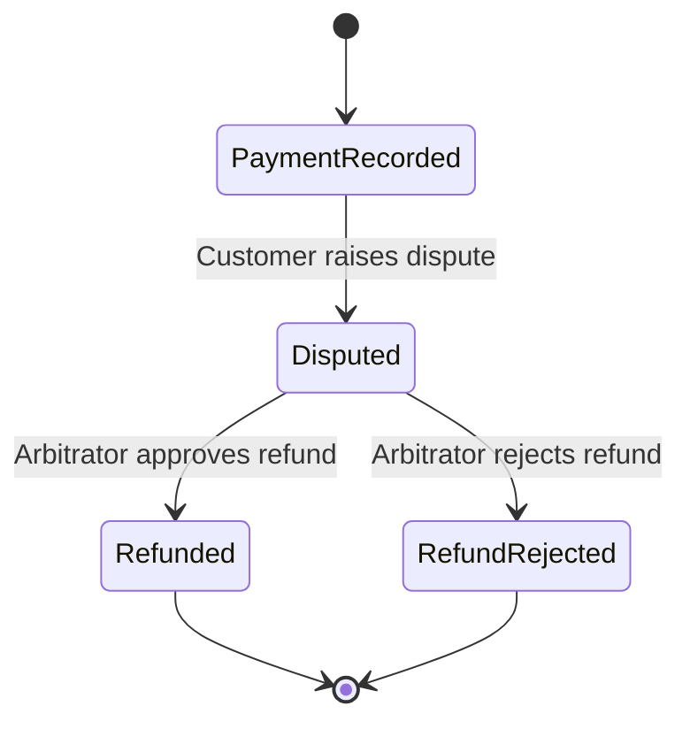
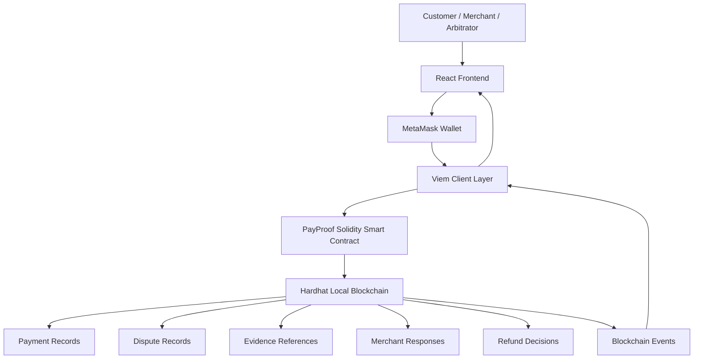
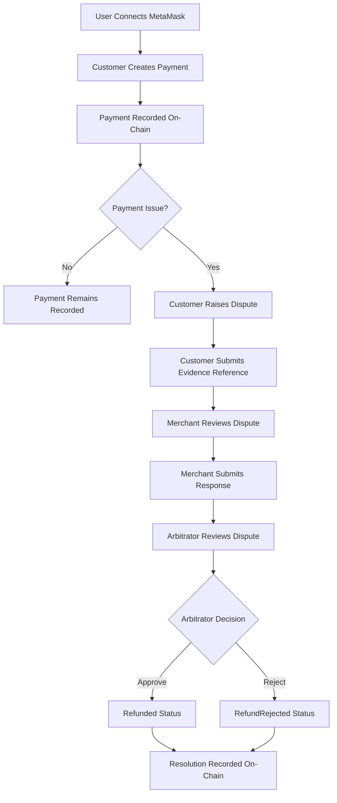

# PayProof
## Blockchain-Based Payment Dispute and Refund Resolution Platform

<p align="center">

**Building trust through transparent, verifiable, and accountable dispute resolution.**

</p>

<p align="center">

`Blockchain` · `FinTech` · `Smart Contracts` · `Ethereum` · `React` · `Solidity`

</p>

---

## 1. Executive Summary

PayProof is a blockchain-based payment dispute management platform designed to improve transparency, accountability, and traceability in digital payment dispute resolution.

In conventional payment ecosystems, disputes between customers and merchants are typically managed through centralized processes. These processes may involve multiple intermediaries, limited visibility into dispute progress, and challenges in maintaining an independently verifiable record of evidence and decisions.

PayProof introduces a smart-contract-driven dispute resolution workflow that creates a transparent and tamper-resistant audit trail of simulated payments, customer disputes, evidence references, merchant responses, and arbitrator decisions.

The platform enables customers to initiate payment records and raise disputes, merchants to submit counter-responses, and authorized arbitrators to approve or reject refund requests. Each permitted state transition is recorded on the blockchain and associated with verifiable transaction events.

The system combines a modern React-based fintech interface with Solidity smart contracts deployed on a local Ethereum-compatible Hardhat network.

**PayProof is currently an academic proof of concept.** Payments and refund decisions are simulated on a local blockchain. The platform does not currently process real UPI, banking, card, or cryptocurrency payments, nor does it execute real-money refunds.

---

## 2. Product Vision

To establish a transparent and verifiable framework for managing digital payment disputes, enabling customers, merchants, and dispute resolution authorities to interact through a shared, tamper-resistant transaction record.

### Mission

- Improve visibility into payment dispute workflows.
- Establish accountability among participating stakeholders.
- Maintain verifiable records of dispute evidence references and decisions.
- Enforce role-based authorization through smart contracts.
- Demonstrate how blockchain can support trust-oriented financial applications.

---

## 3. Problem Statement

Digital commerce depends on reliable payment systems and effective dispute resolution mechanisms. However, conventional dispute management workflows can present several challenges.

### Key Challenges

**Limited Transparency**

Customers and merchants may have limited visibility into the sequence of events and decisions involved in a dispute.

**Centralized Record Management**

Dispute records are commonly maintained by centralized service providers, requiring participants to trust the integrity and availability of those records.

**Evidence Traceability**

Evidence submitted during a dispute may be difficult to independently verify against the record of the resolution process.

**Accountability Gaps**

Without a clearly documented sequence of actions, it can be difficult to establish which participant submitted a response or authorized a decision.

**Complex Resolution Workflows**

Dispute handling involves several stakeholders and multiple stages, making it important to maintain a consistent and auditable process.

PayProof addresses these challenges through blockchain-based record management and smart-contract-enforced workflow controls.

---

## 4. Proposed Solution

PayProof provides a blockchain-backed dispute management workflow.

The application records simulated payment information through a smart contract. Customers can initiate disputes against eligible payments and submit cryptographic evidence references. Merchants can respond with fulfillment statements or counter-evidence. An authorized arbitrator reviews the dispute record and determines whether the refund request should be approved or rejected.

The smart contract enforces authorization rules and prevents invalid state transitions. Blockchain events and transaction records provide a verifiable history of the dispute lifecycle.

### Core Solution Components

- Blockchain-based payment record creation
- Customer dispute escalation
- Cryptographic evidence reference management
- Merchant counter-response mechanism
- Arbitrator-controlled refund decisions
- Role-based access control
- On-chain transaction history
- React dashboard for stakeholder interaction

---

## 5. Stakeholders and User Roles

### Customer

The customer initiates simulated payments and can raise disputes against eligible payment records.

Responsibilities:
- Create payment records
- View payment details
- Raise disputes
- Submit or update evidence references
- Track dispute status

### Merchant

The merchant is the designated recipient associated with a payment record.

Responsibilities:
- Review customer disputes
- Submit responses
- Provide fulfillment statements or counter-evidence
- Track dispute outcomes

### Arbitrator

The arbitrator is the authorized dispute resolution participant.

Responsibilities:
- Review dispute records
- Examine customer evidence references
- Review merchant responses
- Approve refund requests
- Reject refund requests

The arbitrator role is protected through smart-contract access control.

### System

The system manages:
- Payment record creation
- State transitions
- Authorization checks
- Blockchain event emission
- Transaction history retrieval

---

## 6. Key Features

### 6.1 Simulated Payment Record Creation

Users can create payment records containing:

- Unique payment ID
- Customer wallet address
- Merchant wallet address
- Payment amount
- Timestamp
- Payment status

Payment records are stored on-chain through the PayProof smart contract.

### 6.2 Customer Dispute Escalation

Customers can raise disputes against eligible payment records.

The dispute contains:
- Payment identifier
- Dispute reason
- Initial evidence hash or reference
- Updated dispute status

The smart contract restricts dispute creation to the original customer and prevents invalid or duplicate dispute transitions.

### 6.3 Cryptographic Evidence Management

PayProof supports the submission and updating of cryptographic evidence references during an active dispute.

Evidence may include references to:
- Digital receipts
- Product photographs
- Delivery documentation
- Fulfillment records
- Other dispute-related files

The blockchain stores the evidence reference or hash rather than the full file.

In a production-oriented implementation, sensitive evidence files should be stored in an appropriate off-chain storage system. The integrity of the stored content can then be verified using its cryptographic hash.

### 6.4 Merchant Counter-Response

The designated merchant can submit a response to an active dispute.

Examples include:
- Fulfillment statements
- Delivery confirmations
- Shipping information
- Merchant explanations

The smart contract restricts merchant responses to the authorized merchant associated with the payment.

### 6.5 Smart Contract Arbitration

The arbitrator evaluates the dispute and executes a resolution decision.

Two outcomes are supported:

**Refund Approved**

The arbitrator rules in favor of the customer. The payment record transitions to the `Refunded` state.

**Refund Rejected**

The arbitrator rules in favor of the merchant. The payment record transitions to the `RefundRejected` state.

The prototype records these decisions on-chain. It does not currently reverse or transfer real payment funds.

### 6.6 Blockchain Audit Trail

PayProof provides a transaction ledger containing payment records and their current statuses.

The ledger supports:
- Batch payment retrieval
- Searchable transaction records
- Status-based filtering
- Payment detail inspection
- Blockchain-backed status tracking

### 6.7 MetaMask Wallet Integration

The application integrates MetaMask using Viem.

Supported capabilities include:
- Wallet connection
- Account change detection
- Network detection
- Hardhat Local network switching
- Role identification based on connected address
- Transaction signing
- Transaction feedback and error handling

---

## 7. Payment Lifecycle and State Management

PayProof implements a four-stage payment lifecycle.

| State | Value | Description |
|---|---:|---|
| `PaymentRecorded` | 0 | Payment record has been created |
| `Disputed` | 1 | Customer has initiated a dispute |
| `Refunded` | 2 | Arbitrator approved the refund request |
| `RefundRejected` | 3 | Arbitrator rejected the refund request |

### Lifecycle Diagram



### State Transition Rules

- A payment begins in the `PaymentRecorded` state.
- Only the original customer can raise a dispute.
- A dispute can be raised only against an eligible payment.
- Evidence updates are permitted during an active dispute.
- Only the designated merchant can submit a merchant response.
- Only the authorized arbitrator can resolve a dispute.
- Resolved payment records cannot undergo further dispute resolution transitions.

These controls are implemented through smart-contract logic.

---

## 8. System Architecture

PayProof follows a layered architecture that separates the user interface, wallet interaction, blockchain communication, and smart-contract logic.



### Architecture Components

**Presentation Layer — React**

Provides the dashboard, payment forms, dispute interfaces, role indicators, and transaction ledger.

**Wallet Layer — MetaMask**

Provides wallet identity and transaction authorization.

**Blockchain Communication Layer — Viem**

Provides public-client and wallet-client interfaces for reading contract data and submitting transactions.

**Smart Contract Layer — Solidity**

Implements payment record management, dispute transitions, evidence references, merchant responses, and arbitration authorization.

**Blockchain Layer — Hardhat**

Provides the local Ethereum-compatible execution environment used for deployment, testing, and demonstration.

---

## 9. Technology Stack

| Layer | Technology | Purpose |
|---|---|---|
| Frontend | React 19 | Interactive user interface |
| Development Server | Vite | Frontend development and build |
| Smart Contracts | Solidity `^0.8.28` | Blockchain business logic |
| Blockchain Framework | Hardhat 3 | Contract development and deployment |
| Blockchain Interaction | Viem | Contract reads and writes |
| Wallet | MetaMask | Wallet connection and transaction signing |
| Local Network | Hardhat Local, Chain ID 31337 | Blockchain execution environment |
| Styling | Custom CSS | Responsive fintech interface |
| Testing | Node.js-based Viem E2E script | Workflow and authorization testing |

---

## 10. Smart Contract Design

The primary smart contract is:

`PayProof.sol`

### Core Functions

| Function | Responsibility |
|---|---|
| `createPayment()` | Creates a simulated payment record |
| `raiseDispute()` | Initiates a customer dispute |
| `openDispute()` | Dispute entry point, where applicable in the implementation |
| `submitEvidence()` | Submits or updates evidence reference |
| `merchantRespond()` | Submits merchant counter-response |
| `resolveDispute()` | Executes an arbitrator decision |
| `approveRefund()` | Approves a refund request |
| `rejectRefund()` | Rejects a refund request |
| `getPayment()` | Retrieves a specific payment |
| `getAllPayments()` | Retrieves payment records in a batch |
| `getPaymentCount()` | Returns the number of payment records |

### Smart Contract Security Controls

The prototype includes:
- Role-based access restrictions
- Customer ownership validation
- Merchant identity validation
- Arbitrator-only resolution
- Duplicate dispute prevention
- State transition validation
- Payment ID validation
- Event-based activity tracking

These controls support the integrity of the application workflow. The prototype has not been represented as a production-audited financial smart contract.

---

## 11. Functional Requirements

| ID | Requirement |
|---|---|
| FR-01 | The system shall allow users to create simulated payment records. |
| FR-02 | The system shall generate unique payment identifiers. |
| FR-03 | The system shall allow the original customer to raise an eligible dispute. |
| FR-04 | The system shall store dispute reasons and evidence references. |
| FR-05 | The system shall allow the customer to update evidence during an active dispute. |
| FR-06 | The system shall allow the designated merchant to submit a response. |
| FR-07 | The system shall restrict dispute resolution to the authorized arbitrator. |
| FR-08 | The system shall support refund approval and rejection decisions. |
| FR-09 | The system shall maintain payment status on the blockchain. |
| FR-10 | The system shall retrieve payment records for the transaction ledger. |
| FR-11 | The system shall allow users to connect through MetaMask. |
| FR-12 | The system shall provide transaction feedback and error handling. |

---

## 12. Non-Functional Requirements

### Security

The system should enforce wallet-based authorization and prevent unauthorized changes to payment or dispute records.

### Transparency

Payment and dispute states should be verifiable through blockchain records.

### Reliability

The frontend should handle transaction failures, network mismatches, and wallet rejection.

### Usability

The application should provide a clear and intuitive interface for customers, merchants, and arbitrators.

### Maintainability

The frontend, blockchain interaction logic, and smart-contract functionality should remain modular and organized.

### Responsiveness

The dashboard should adapt to desktop and mobile screen sizes.

---

## 13. User Workflow



---

## 14. Dashboard and User Experience

PayProof uses a professional fintech-inspired interface with a dark visual theme and blue accent colors.

### Dashboard Components

- Protocol overview
- Wallet connection and role indicator
- Payment record creation
- Active dispute management
- Merchant response interface
- Arbitrator resolution interface
- Transaction ledger
- Payment status filters
- Contract and network information
- Transaction feedback notifications

### Role-Based Interface

The application identifies the connected wallet's role based on its address.

| Role | Dashboard Capabilities |
|---|---|
| Customer | Create payment records, raise disputes, update evidence |
| Merchant | Review disputes and submit responses |
| Arbitrator | Approve or reject refund requests |
| General User | View eligible public payment records |

Frontend role detection improves usability. The smart contract remains the authoritative enforcement layer for permissions.

---

## 15. Testing and Verification

PayProof includes an automated end-to-end test script:

`blockchain/scripts/test-e2e.mjs`

The test suite executes the payment dispute lifecycle and validates smart-contract behavior.

### E2E Test Coverage

| Test | Scenario | Expected Result |
|---|---|---|
| TC-01 | Customer creates payment | Payment record created |
| TC-02 | Customer raises dispute | Status changes to `Disputed` |
| TC-03 | Customer updates evidence | Evidence reference updated |
| TC-04 | Merchant submits response | Merchant response recorded |
| TC-05 | Arbitrator approves refund | Status changes to `Refunded` |
| TC-06 | Customer creates another payment | New payment ID generated |
| TC-07 | Customer raises second dispute | Dispute successfully opened |
| TC-08 | Merchant responds to second dispute | Response recorded |
| TC-09 | Arbitrator rejects refund | Status changes to `RefundRejected` |
| TC-10 | Unauthorized customer attempts approval | Transaction reverts |
| TC-11 | Non-customer attempts dispute | Transaction reverts |
| TC-12 | Non-merchant submits response | Transaction reverts |
| TC-13 | Batch ledger retrieval | Payment records returned |

The repository's reported E2E execution passed all 11 workflow stages. The detailed tests include multiple successful and reverted transactions.

To independently verify the test suite, run:

```bash
npm run test:e2e
```

---

## 16. Installation and Setup

### Prerequisites

- Node.js
- npm
- Git
- MetaMask browser extension
- VS Code or another development environment

### Clone the Repository

```bash
git clone https://github.com/daksh541/PayPal.git
cd PayPal
```

### Install Project Dependencies

Install the dependencies for the project using the package manifests.

```bash
npm install
```

If the root package does not install workspace dependencies, install the frontend and blockchain dependencies separately:

```bash
cd blockchain
npm install
cd ../frontend
npm install
cd ..
```

---

## 17. Running the Application

PayProof requires a local blockchain, a deployed smart contract, and the frontend.

### Terminal 1 — Start the Hardhat Local Blockchain

```bash
cd blockchain
npm run node
```

The local node should listen at:

```text
http://127.0.0.1:8545
```

Network details:

| Parameter | Value |
|---|---|
| Network | Hardhat Local |
| Chain ID | 31337 |
| RPC URL | `http://127.0.0.1:8545` |
| Currency | ETH |

Keep the node terminal running.

### Terminal 2 — Deploy the Contract and Seed Demo Data

```bash
cd blockchain
npm run deploy
```

This command deploys the PayProof contract to the local node, seeds demo payment records, and updates the frontend contract configuration.

The contract address is generated by the deployment process. Use the latest deployed address rather than relying on a previously saved address.

### Terminal 3 — Start the Frontend

```bash
cd frontend
npm run dev
```

Open:

[http://localhost:5173](http://localhost:5173)

---

## 18. MetaMask Configuration

### Add Hardhat Local Network

| Setting | Value |
|---|---|
| Network Name | Hardhat Local |
| RPC URL | `http://127.0.0.1:8545` |
| Chain ID | `31337` |
| Currency Symbol | ETH |

Connect MetaMask through the PayProof dashboard.

### Demo Roles

The local Hardhat accounts are used for demonstration.

- Account #0: Arbitrator
- Account #1: Customer
- Account #2: Merchant

These accounts use publicly known test private keys generated by Hardhat.

**Security Notice:** These accounts are strictly for local development. Never use their private keys on a public network or with real funds.

---

## 19. Demonstration Scenario

A typical demonstration follows this workflow:

### Step 1 — Customer Creates Payment

The customer connects MetaMask and creates a simulated payment record.

### Step 2 — Customer Raises Dispute

The customer selects an eligible payment and submits a dispute reason and evidence reference.

### Step 3 — Merchant Responds

The merchant connects their wallet and submits a counter-response.

### Step 4 — Arbitrator Reviews

The arbitrator connects their wallet and reviews the dispute record, evidence reference, and merchant response.

### Step 5 — Refund Decision

The arbitrator approves or rejects the refund request.

### Step 6 — Blockchain Verification

The transaction ledger displays the updated payment status and associated records.

This demonstration showcases the complete dispute lifecycle through the React frontend and Solidity smart contract.

---

## 20. Limitations

PayProof is an academic proof of concept and has the following limitations:

- Payments are simulated.
- The prototype does not process real UPI, card, or bank payments.
- Refund decisions do not execute real-money transfers.
- The arbitrator is centrally designated.
- The application uses a local Hardhat blockchain.
- Evidence references are demonstrated using sample IPFS-style values.
- The smart contract has not been represented as professionally audited.
- Production deployment would require additional infrastructure, compliance controls, and security testing.

---

## 21. Future Scope

The platform can be extended with the following capabilities.

### Production Payment Integration

Integrate authorized payment gateway APIs to connect dispute records with real payment transaction identifiers.

### Escrow-Based Payment Handling

Introduce a separate escrow smart contract that holds test tokens and releases or refunds them according to verified dispute decisions.

### Decentralized Arbitration

Replace the single arbitrator with a multi-arbitrator or voting-based dispute resolution mechanism.

### Decentralized Evidence Storage

Integrate IPFS or another appropriate storage layer for evidence files, with cryptographic verification.

### Notification System

Provide notifications for dispute creation, merchant responses, and resolution decisions.

### Merchant Reputation System

Build a reputation mechanism based on dispute outcomes and transaction history.

### Public Testnet Deployment

Deploy the smart contract to an EVM-compatible public testnet for broader demonstration and testing.

### Security Auditing

Conduct professional smart-contract audits, formal verification, and comprehensive security testing before any production financial integration.

---

## 22. Business and Technical Value

PayProof demonstrates the potential of blockchain technology in financial workflow management.

### Business Value

- Greater visibility into dispute handling
- Improved stakeholder accountability
- Verifiable transaction records
- Structured dispute workflows
- Better traceability of resolution decisions

### Technical Value

- Smart-contract-based workflow enforcement
- Role-based access control
- Blockchain event-driven records
- Ethereum-compatible architecture
- Wallet-based user interaction
- Automated end-to-end testing

PayProof is designed as a demonstration of how decentralized technologies can support trust-oriented financial applications.

---

## 23. Conclusion

PayProof demonstrates a blockchain-based approach to payment dispute management by combining Solidity smart contracts, Ethereum-compatible infrastructure, and a modern React interface.

The application provides a structured workflow for simulated payment creation, customer dispute escalation, evidence reference management, merchant responses, and arbitrator-controlled refund decisions.

By maintaining payment and dispute states on-chain, PayProof establishes a transparent and verifiable audit trail that demonstrates the practical value of blockchain technology in financial workflow management.

The project serves as an academic proof of concept for a more accountable and traceable payment dispute resolution framework, while identifying the additional security, compliance, and integration requirements necessary for a production-ready financial platform.

---

## 24. Repository

GitHub:

https://github.com/daksh541/PayPal

### Project Components

- `blockchain/` — Solidity contracts, Hardhat configuration, deployment and testing scripts
- `frontend/` — React application and dashboard
- `README.md` — Project documentation and setup instructions

---

## License

Add the license applicable to this project if one has been selected.

---

<p align="center">

**PayProof — Trust, Transparency, and Accountability in Digital Payment Dispute Resolution.**

</p>
